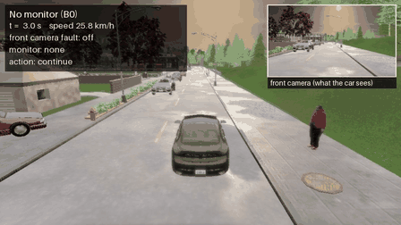
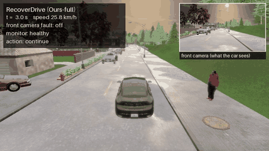

# RecoverDrive

A fault-aware monitor for autonomous-driving perception: **detect → diagnose → recover → verify → fallback**.
Deterministic checks compare the LiDAR with six cameras, Qwen3-VL decides which sensor is faulty, a recovery
controller isolates it, and a rule-based shield picks *continue*, *slow_down* or *stop*. Evaluated on nuScenes-mini
with injected faults and in CARLA. The project builds on DriveAgent ([Hou et al., 2025](https://arxiv.org/abs/2505.02123));
its text-chain reasoning is re-implemented here as baselines B1–B3.

## Demo

CARLA, same route and seed. While a pedestrian crosses, the front camera shows the rear view (fault C1); the inset
shows what the car sees. Playback at 2× speed.

| No monitor (B0) | RecoverDrive (Ours-full) |
|---|---|
|  |  |
| The car does not see the pedestrian and hits them. | On the first faulty frame the monitor flags the front camera, isolates it and slows to about 8 km/h; the pedestrian has crossed before the car arrives. |

These are example runs. Around 20 s the monitor briefly restores the camera, because nothing is in view to cross-check,
and then isolates it again. Over all 72 closed-loop runs, the car collided in 7 of 12 runs with this fault without the
monitor and in 0 of 12 with it.

## Requirements

| | Minimum |
|---|---|
| OS / GPU | Linux, one NVIDIA GPU with ≥ 32 GB free (VLM server ~24 GB + SAM 3 ~3 GB). Tested on RTX 6000 Ada 48 GB. |
| Driver | NVIDIA driver with CUDA 13 support (tested: 580) |
| Tools | [uv](https://docs.astral.sh/uv/) ≥ 0.12 (it installs Python 3.12), `wget` |
| Disk | ~45 GB: Python envs ~12 GB, nuScenes-mini ~5 GB (+4 GB while downloading), model weights ~21 GB |
| Accounts | [Hugging Face](https://huggingface.co) account with approved access to [facebook/sam3](https://huggingface.co/facebook/sam3) |
| Optional | CARLA 0.9.16 (~28 GB) and the NVIDIA Vulkan driver, only for the closed-loop experiment (E3) |

## Repository layout

```
src/recoverdrive/   pipeline package: checks, faults, VLM client, recovery, shield, methods, metrics, runner
  adapters/         nuScenes and CARLA → Frame
  detectors/        SAM 3 (default) and Qwen3-VL grounding (ablation)
scripts/            entry points (run_eval.py, run_e3.py, ...) and setup helpers (env.sh, download_*.sh, serve_vlm.sh)
configs/            eval.yaml (frozen settings), splits.yaml (dev/test scenes), e3.yaml (CARLA overrides)
serving/            separate uv project that only holds vLLM
tests/              unit tests (pytest)
docs/superpowers/   design spec (in Traditional Chinese), plans, run logs
```

## Setup

Run every command from the repository root.

**1. Clone and set the environment.** `scripts/env.sh` must be sourced in every new shell.

```bash
git clone git@github.com:maxshen1212/recoverdrive.git && cd recoverdrive
export UV_CACHE_DIR=~/.cache/uv     # only if you have no /data disk (env.sh defaults to /data/$USER/.cache/uv)
export HF_HOME=~/.cache/huggingface # optional: where model weights go (~21 GB)
source scripts/env.sh
```

**2. Install the two Python environments** (pinned by `uv.lock` and `serving/uv.lock`):

```bash
uv sync                      # main env (.venv): torch, transformers, nuScenes devkit, CARLA client
uv sync --project serving    # vLLM env (serving/.venv)
uv run pytest -q             # all tests should pass
```

**3. Download the data**: nuScenes v1.0-mini (4.2 GB) into `data/nuscenes`. By downloading you accept the
[nuScenes terms of use](https://www.nuscenes.org/terms-of-use).

```bash
./scripts/download_nuscenes_mini.sh
```

**4. Download the models.** SAM 3 is gated: first request access on its
[model page](https://huggingface.co/facebook/sam3) and wait for the approval e-mail.

```bash
uv run hf auth login           # paste a Hugging Face read token
./scripts/download_models.sh   # SAM 3 + Qwen3-VL-8B-Instruct (~21 GB); add --ablation for the E5 models
```

## Quick start

**1. Start the VLM server** (vLLM serving Qwen3-VL-8B on port 8000) and wait until it is ready:

```bash
CUDA_VISIBLE_DEVICES=0 VLM_GPU_UTIL=0.5 ./scripts/serve_vlm.sh > vllm.log 2>&1 &
until curl -sf http://127.0.0.1:8000/health; do sleep 10; done; echo ready    # ~2-5 min
```

`VLM_GPU_UTIL` is the share of the GPU's memory the server takes; set it to about 24 GB / GPU memory
(0.5 on a 48 GB card, 0.75 on 32 GB, 0.3 on 80 GB). SAM 3 runs in the experiment process on the GPU in
`CUDA_VISIBLE_DEVICES` (default 0).

**2. Quick check** (one dev scene, one fault, ~5 min):

```bash
uv run python scripts/run_eval.py --split dev --scenes scene-0061 --faults C1 \
    --methods B0 ours_detect ours_full --seeds 0 --tag quick
```

It prints the E1 (detection) and E2 (fallback) tables and saves them to `outputs/eval/quick/summary.md`. This is a
smoke test: a single scene gives very different numbers from the full evaluation.

**3. Main experiment** (test split, all methods and faults, 3 seeds; ~3 h with two VLM servers, ~6 h with one):

```bash
uv run python scripts/run_eval.py --split test --faults all \
    --methods B0 B1 B2 B3 ours_detect ours_full --seeds 0 1 2 --tag test_final
```

- The test split runs only with `frozen: true` in `configs/eval.yaml` (already set) and no uncommitted changes.
- Runs are resumable: rerun the same command to finish missing runs.
- For a second server, start another one with `VLM_PORT=8001` on another GPU; servers that are not running are skipped.

**4. Stop the server** when done: `pkill -INT -f "[v]llm serve"`

## Closed-loop experiment in CARLA (optional, E3)

```bash
wget https://carla-releases.s3.us-east-005.backblazeb2.com/Linux/CARLA_0.9.16.tar.gz       # 8.3 GB
mkdir -p ~/carla/CARLA_0.9.16 && tar xzf CARLA_0.9.16.tar.gz -C ~/carla/CARLA_0.9.16
CARLA_ROOT=~/carla/CARLA_0.9.16 ./scripts/carla_server.sh > carla.log 2>&1 &              # headless, ~5 GB GPU
uv run python scripts/run_e3.py --seeds 0 1 2 --tag e3_final                              # VLM server must be running
pkill -INT -f "[C]arlaUE4-Linux-Shipping"
```

The CARLA Python client is installed by `uv sync`. `carla_server.sh` needs the NVIDIA Vulkan driver
(`nvidia_icd.json`; set `VK_ICD_FILENAMES` if it is not in `/etc/vulkan/icd.d/` or `/usr/share/vulkan/icd.d/`).

## Other experiments

| Experiment | Command |
|---|---|
| Dev split, faults C1/L1/A1 | `uv run python scripts/run_eval.py --split dev --faults C1 L1 A1 --methods ours_detect --seeds 0 --tag p1` |
| Threshold calibration (dev) | `uv run python scripts/calibrate.py --tag calib_dev` |
| E4 latency | two runs tagged `e4_ours` / `e4_baselines` with `--workers 1 --sequential --no-precompute --cache <new file>`, then `uv run python scripts/latency_report.py` |
| E5 recovery ablations (offline) | `uv run python scripts/replay_ablation.py --tag test_final` (after the main experiment) |
| E5 component ablations | add `--ablation no_checks` or `--ablation qwen_grounding` to the main-experiment command, with `--methods ours_detect ours_full` |
| E5 model ablations | serve the model with `VLM_MODEL=Qwen/Qwen3-VL-4B-Instruct VLM_SERVED_NAME=qwen3-vl-4b-instruct VLM_GPU_UTIL=0.4 ./scripts/serve_vlm.sh`, then add `--vlm-model qwen3-vl-4b-instruct` (Thinking: `Qwen/Qwen3-VL-8B-Thinking`, served with `--reasoning-parser qwen3`, run with `--vlm-max-tokens 4096`) |
| Figures and tables | `uv run python scripts/make_figures.py` (writes `report_figures/`) |
| Demo GIFs | `uv run python scripts/run_e3.py --methods B0 ours_full --conditions C1 --seeds 0 --only-route 1 --record --tag demo`, then `uv run python scripts/make_demo_gif.py outputs/e3/demo/<run>_frames docs/media/<name>.gif --start 3 --end 24` |

Results go to `outputs/` and `report_figures/` (not tracked). Lint: `uv run ruff check src tests scripts`.

## Citation

This project builds on DriveAgent:

```bibtex
@article{hou2025driveagent,
  title   = {DriveAgent: Multi-Agent Structured Reasoning with LLM and Multimodal Sensor Fusion for Autonomous Driving},
  author  = {Hou, Xinmeng and Wang, Wuqi and Yang, Long and Lin, Hao and Feng, Jinglun and Min, Haigen and Zhao, Xiangmo},
  journal = {arXiv preprint arXiv:2505.02123},
  year    = {2025}
}
```
